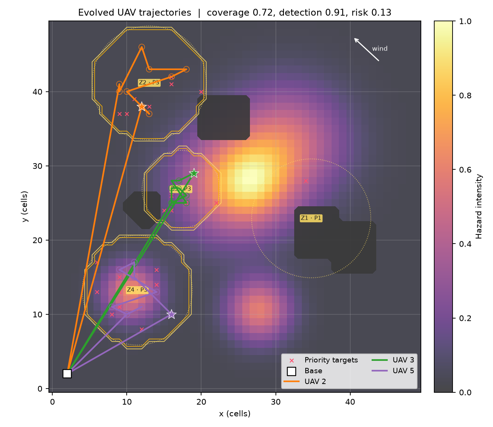
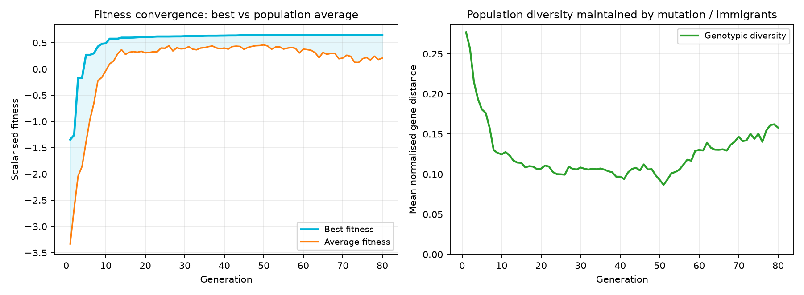
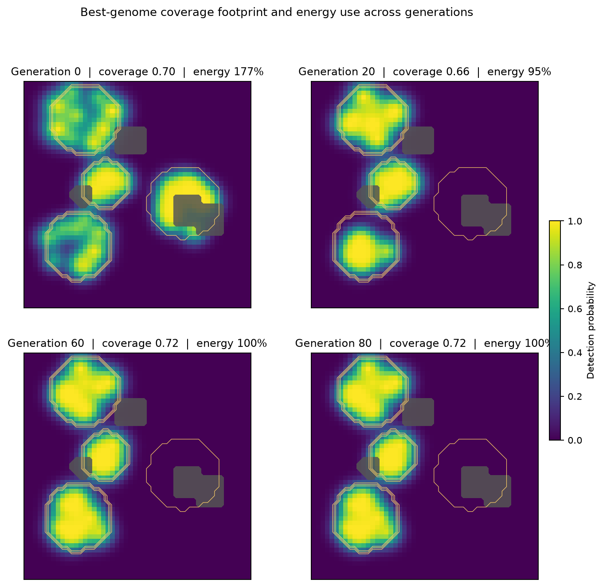
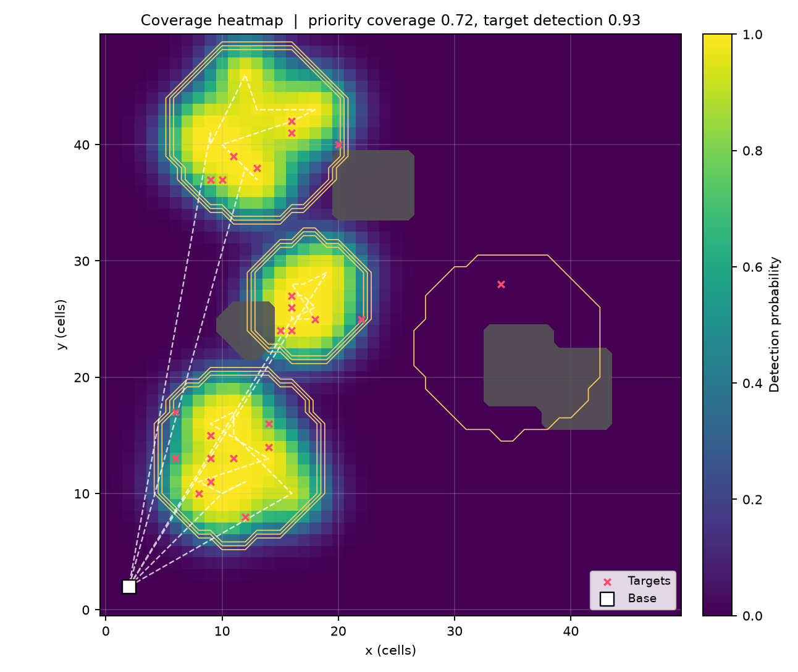
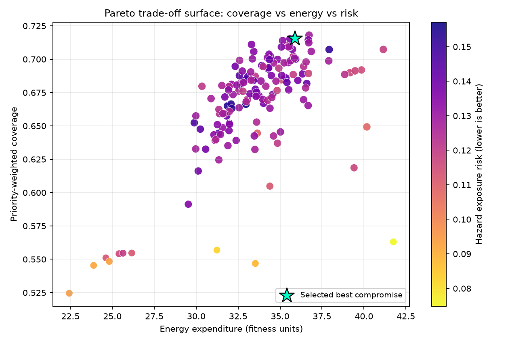

# 🚁 Multi-Objective UAV Strategy Engine

**Disaster Management & Autonomous Surveillance — Genetic Algorithm Strategy Engine**

A modular Python research implementation that evolves deployment positions, patrol
waypoints, sensor activation schedules and leg speeds for a fleet of UAVs surveying a
volatile hazard grid. It is built for the **Artificial Intelligence (BSCS 5) — Assignment 2
(CLO4)** brief at Bahria University Lahore Campus: *apply knowledge representation and
inference techniques to a practical multi-objective problem*.



---

## Why this problem is interesting

Five UAVs must cover weighted disaster zones, detect priority targets, avoid restricted
airspace and radiation pockets, respect per-drone range limits, and do all of this without
wasting battery or mission time. These goals conflict. There is no single "correct" answer,
so the engine searches for a **family of trade-off solutions** using a custom Genetic
Algorithm and maintains a Pareto archive alongside the scalarised best strategy.

Reference run (50 × 50 grid, 5 UAVs, 80 generations, population 60, about 24 s):

| Metric | Result |
|---|---|
| Priority-weighted coverage | **0.716** |
| Weighted target detection | **0.908** (92.6% confident detections at p ≥ 0.5) |
| Fleet energy | 35.9 / 36 budget (100%) |
| Mission time | 86% of budget |
| Hazard exposure | 0.130 |
| No-fly violations | **0.000** |
| Active UAVs | 3 of 5 (2 held in reserve) |
| Pareto archive | **149** non-dominated strategies |
| Evaluations | 4,701 |

Compared with the hotspot-seeded generation-0 solution, the final strategy keeps coverage
at 0.72 while cutting energy from **177% to 100%** of budget and reducing the active fleet
from 5 to 3 UAVs.

---

## Visual outputs

| Fitness convergence | Coverage evolution |
|---|---|
|  |  |

| Final coverage heatmap | Pareto trade-off surface |
|---|---|
|  |  |

The sensitivity and random-search comparison figures are under
[`outputs/experiments/`](outputs/experiments/), and the technical report is
[`REPORT.md`](REPORT.md) / [`docs/TECHNICAL_REPORT.pdf`](docs/TECHNICAL_REPORT.pdf).

A companion analysis report covers the chromosome and fitness-weight rationale,
hyperparameter sensitivity, and the evolved solution's uniqueness against random search:
[`docs/ANALYSIS_REPORT.pdf`](docs/ANALYSIS_REPORT.pdf) (editable:
[`docs/ANALYSIS_REPORT.docx`](docs/ANALYSIS_REPORT.docx)).

---

## Repository structure

```text
uav-strategy/
├── uav_strategy/
│   ├── config.py          # Mission, GA, fitness and experiment configuration
│   ├── environment.py     # 50×50 hazard grid, zones, no-fly areas, targets, wind
│   ├── genome.py          # Hybrid 190-gene chromosome
│   ├── fitness.py         # Five-objective evaluation + penalties
│   ├── operators.py       # Geometric / segment / splice crossover, mutation, repair
│   ├── selection.py       # Tournament, rank, roulette selection + diversity
│   ├── pareto.py          # NSGA-II non-dominated sorting & crowding distance
│   ├── ga.py              # Genetic strategy engine (weighted or Pareto mode)
│   ├── baseline.py        # Equal-budget random-search baseline
│   ├── experiments.py     # Sensitivity analysis + baseline study
│   ├── visualize.py       # All plots (Agg backend)
│   ├── simulation.py      # End-to-end run + artefact generation
│   ├── webapp.py          # Flask dashboard (background jobs + JSON API)
│   ├── templates/         # Dashboard markup (index.html)
│   ├── static/            # Dashboard CSS + JavaScript
│   └── cli.py             # `python -m uav_strategy ...`
├── app.py                 # `python app.py` launches the browser dashboard
├── run_windows.bat        # One-click Windows setup + dashboard
├── run_linux.sh           # One-command Linux/macOS setup + dashboard
├── commands.txt           # Linux/macOS command reference
├── tests/                 # 28 unit tests
├── scripts/
│   └── build_report.py    # Generates REPORT.md, DOCX and PDF from run data
├── outputs/
│   ├── run/               # Reference simulation artefacts and figures
│   ├── experiments/       # Sensitivity, baseline and comparison figures
│   ├── ui_runs/           # Dashboard runs (generated on demand)
│   └── ui_previews/       # Cached mission previews (generated on demand)
├── docs/                  # TECHNICAL_REPORT + ANALYSIS_REPORT (DOCX/PDF/MD)
├── REPORT.md              # Technical report (Markdown source)
├── requirements.txt
└── pyproject.toml
```

---

## Quick start

### Windows

Double-click **`run_windows.bat`**. It finds Python 3.10+, creates `.venv`,
installs the requirements, and starts the dashboard at
[http://127.0.0.1:5000](http://127.0.0.1:5000).

```bat
run_windows.bat
run_windows.bat --port 8000 --no-browser
```

### Linux / macOS

```bash
./run_linux.sh                 # setup + install + launch
./run_linux.sh --port 8000     # custom port
```

See [`commands.txt`](commands.txt) for the full Linux/macOS command reference,
including manual setup, CLI runs, tests and troubleshooting.

### Manual setup

```bash
python3 -m venv .venv
source .venv/bin/activate
pip install -r requirements.txt

# Reproduce the reference simulation and all figures
python -m uav_strategy run --generations 80 --population 60

# Run the sensitivity study and equal-budget random-search comparison
python -m uav_strategy experiments --generations 40

# Rebuild the Markdown/DOCX/PDF technical report from the generated JSON data
python scripts/build_report.py

# Run the test suite
python -m unittest discover -s tests -v
```

> Tested with Python 3.14 and NumPy 2.5. The code targets Python 3.10+.

### Web dashboard

Prefer a browser to the CLI? Start the local dashboard:

```bash
python app.py                 # opens http://127.0.0.1:5000
# or
python -m uav_strategy ui --port 8000 --no-browser
```

The dashboard lets you:

- choose grid size, fleet size, patrol points and a random seed;
- tune population, generations, mutation rate, tournament size and
  weighted-elite vs NSGA-II Pareto survival;
- rebalance the five objective weights with presets or sliders;
- preview the generated mission map before running;
- watch fitness, coverage, energy and hazard risk update live while the GA runs;
- inspect trajectories, coverage heatmaps, convergence, coverage evolution and the
  Pareto front, then download the genome, history, Pareto archive and config as JSON.

Runs are saved under `outputs/ui_runs/<job_id>/` and previews under
`outputs/ui_previews/`. Missions are generated server-side at 50 × 50 by default, with
range, time, energy and sensor budgets scaled automatically to the chosen grid size.

### CLI options

```bash
python -m uav_strategy run \
  --output outputs/run \
  --grid-size 50 \
  --drones 5 \
  --population 60 \
  --generations 80 \
  --mutation-rate 0.20 \
  --tournament-size 4 \
  --mode weighted          # or: pareto (NSGA-II survival)
  --seed 7
```

---

## Method summary

### 1. Chromosome representation (190 genes for 5 UAVs × 8 patrol points)

| Segment | Shape | Type | Meaning |
|---|---|---|---|
| `active` | 5 | binary | UAV on / held in reserve |
| `deploy` | 5 × 2 | real | deployment / loiter position |
| `patrol` | 5 × 8 × 2 | real | ordered patrol waypoints |
| `sensor` | 5 × 9 | real ∈ [0, 1] | sensor power at deployment + waypoints (0 = OFF) |
| `speed` | 5 × 10 | real ∈ [0.55, 2.0] | speed gene for each leg |

The closed path is `base → deploy → patrol[0..K-1] → base`. Separating deployment from the
patrol route lets a UAV loiter over a hotspot before sweeping its route; per-leg speed genes
make the time–energy trade-off explicit.

### 2. Multi-objective fitness

Sensors are fused with a noisy-OR footprint model, then five objectives are computed:
priority-weighted coverage `C`, weighted detection `D`, energy `E`, time `T` and hazard
exposure `R`. The default scalarisation is

```text
f = 0.45·C + 0.15·D + 0.10·(1 − E/36) + 0.10·(1 − T/240) + 0.20·(1 − R) − penalty
```

with penalties for no-fly crossings, minimum coverage deficits, range excess and time
excess. The five-tuple `(−C, −D, E, T, R)` is also retained for Pareto archiving and the
optional NSGA-II mode.

### 3. Custom genetic operators

- **Geometric BLX-α crossover** for coordinates with a per-drone blend weight, preserving
  route shape while recombining spatial strategies.
- **Segment-swap crossover** for entire UAV missions (deployment + patrol + schedule).
- **Route-splice crossover** that cuts and joins patrol subsequences.
- **Spatially aware mutation**: damped Gaussian waypoint jitter, long-range teleport,
  route reversal/rotation, sensor power tuning/on-off, speed changes, rare activation
  toggles and full-drone re-initialisation.
- **Tournament selection**, 2 elites, 4% random immigrants and adaptive mutation intensity
  when progress stalls.

### 4. Constraint handling

Hard constraints are handled by a combination of **repair** and **penalty**:

- Coordinates are clipped to the grid.
- Waypoints inside no-fly zones are projected to the nearest free cell.
- An over-range UAV alone is contracted toward the base until its own closed route is
  within the 175-cell limit (the fleet-total variant was found to collapse coverage).
- No-fly leg crossings, coverage deficit, time excess and residual range excess are
  penalised in the fitness function.

---

## Reproducibility

- Mission generation seed: `42`
- Reference GA seed: `7`
- Experiment seeds: `11`, `23`
- All figures are regenerated deterministically from these seeds.
- Raw histories, best genomes, Pareto archives, configs and sensitivity runs are saved as
  JSON under `outputs/`.

---

## Assignment deliverables mapping

| Requirement | Where |
|---|---|
| GitHub repository structure, README, requirements | this repository |
| Object-oriented chromosome, population, selection, crossover, mutation, termination | `uav_strategy/genome.py`, `ga.py`, `operators.py`, `selection.py` |
| Fitness convergence (best vs average) | `outputs/run/figures/fitness_convergence.png` |
| Flight paths and coverage heatmaps across generations | `outputs/run/figures/evolved_paths.png`, `coverage_heatmap.png`, `coverage_evolution.png` |
| Brief technical report (3–5 pages) | `REPORT.md`, `docs/TECHNICAL_REPORT.pdf` |
| Interactive browser UI for configuring and running the engine | `python app.py`, `uav_strategy/webapp.py` |
| Sensitivity analysis and random-search comparison | `outputs/experiments/`, report §5.2–5.3 |

---

## Limitations & future work

The current mission uses one static hazard map, direct-line legs between waypoints and no
communication constraints. Promising extensions are A*-smoothed obstacle-free legs, dynamic
plume drift, battery degradation, multi-mission scheduling and a rolling-horizon GA for
in-flight replanning.

---

*Course: Artificial Intelligence — BSCS 5, Bahria University Lahore Campus.*
