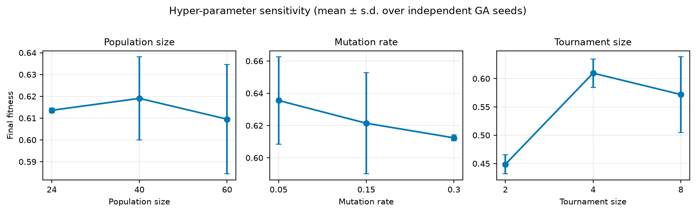
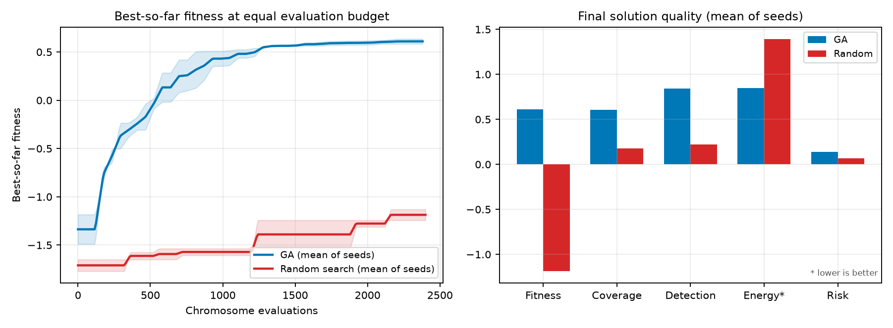

# Multi-Objective Genetic Strategy Engine for Autonomous UAV Disaster Surveillance

*Artificial Intelligence — BSCS 5, Department of Computer Science, Bahria University Lahore Campus*  
*Assignment 2 (CLO4) — Team of 3: ____________________, ____________________, ____________________*  

## Abstract

This report documents a modular genetic-algorithm (GA) strategy engine for a fleet of five UAVs surveying a volatile 50 × 50 hazard grid. The engine co-evolves deployment positions, patrol trajectories, sensor power schedules and leg speeds. A hybrid real-valued/integer chromosome is evaluated by a weighted five-objective fitness function that rewards priority-zone coverage and target detection while penalising energy, flight time and hazard exposure. Custom geometric, segment-swap and route-splice crossover operators, spatially aware mutation, elitism, immigrants and repair mechanisms maintain feasibility and diversity. On the reference mission the evolved strategy reaches 72% priority-weighted coverage and 93% confident target detection with zero no-fly violations, while cutting energy use by 44% relative to the hotspot-seeded starting solution.

## 1. Problem Framing and Design Goals

The mission is deliberately multi-objective: more coverage usually requires longer routes, higher sensor power and therefore more energy, more time and greater exposure to hazard plumes. The world is discretised into a 50 × 50 matrix. Each cell stores a priority weight (three P3 disaster zones and one lower-priority P1 zone), a normalised radiation/toxic-plume intensity, and a binary no-fly flag. Four circular/rectangular restricted blocks and the launch base are also encoded. Twenty-four weighted targets are sampled from the priority distribution to estimate detection performance. A uniform wind vector modulates propulsion energy along each leg.

Five UAVs start from a common base at (2, 2). Each aircraft may be activated or kept in reserve, flies to a deployment point, follows an ordered patrol route and returns to base. The design goals are to (i) cover the highest-priority zones and detect their targets, (ii) respect per-drone range, no-fly and time limits, and (iii) keep energy, duration and hazard exposure low. Because these goals conflict, the output is a family of non-dominated strategies rather than a single rigid answer.

## 2. Chromosome Representation

A fixed-length hybrid chromosome was chosen so that standard genetic operators remain applicable while every gene keeps an explicit operational meaning. The chromosome has five segments and 190 genes for a fleet of five UAVs with eight patrol waypoints:

**Table 1. Hybrid chromosome layout (190 genes).**

| Segment | Shape | Type / range | Operational meaning |
|---|---|---|---|
| active | 5 | binary {0,1} | UAV switched on or held in reserve |
| deploy | 5 × 2 | real, [0,49]² | initial deployment / loiter position |
| patrol | 5 × 8 × 2 | real, [0,49]² | ordered patrol waypoints |
| sensor | 5 × 9 | real, [0,1] | sensor power at deployment + 8 waypoints (0 = off) |
| speed | 5 × 10 | real, [0.55,2.0] | speed gene for each of the 10 traversed legs |

Separating deployment from the patrol segment allows a UAV to loiter over a hotspot before sweeping its route, while per-leg speed genes expose the time–energy trade-off explicitly. Sensor power is a continuous gene rather than a binary switch: values below 0.1 are treated as OFF in the activation schedule, and intermediate values let the optimiser dim sensors where diminishing returns do not justify battery use. Real-valued spatial genes support geometric recombination and smooth local search; the binary activation gene supports fleet sizing decisions. Fixed lengths keep the representation simple and make crossover semantics auditable.

## 3. Multi-Objective Fitness Function

Sensor footprints are fused with a noisy-OR model. A sensor at node j with power p_j contributes q_j(x) = p_j exp(−2.5 d²/r_eff²) to cell x, with r_eff = 5(0.45 + 0.55 p_j). The fused detection probability is Φ(x) = 1 − Π_j (1 − q_j(x)). The five raw objectives are:

```text
C = Σ_x w(x) Φ(x) / Σ_x w(x)                                  (1)  priority coverage
D = Σ_t τ_t Φ(t) / Σ_t τ_t                                    (2)  weighted detection
E = Σ_l d_l (0.06 + 0.05 v_l²) ω_l + 0.12 Σ_j p_j + 0.01 M    (3)  energy
T = Σ_l d_l / v_l + 0.15 Σ_j [p_j > 0.1]                      (4)  mission time
R = (1/|S|) Σ_{s∈S} h(s)                                     (5)  hazard exposure
```

Here w(x) is the priority weight, τ_t target weight, d_l leg length, v_l speed, ω_l the headwind multiplier, M the number of sensor nodes and h(s) hazard intensity at sampled path point s. R̂_range = max_i d_i / 175 is the longest single-drone closed-route fraction, T̂ = T/240 is the normalised mission time and f_nofly is the fraction of sampled leg points inside restricted airspace. Energy is normalised as Ê = E/36 and R is already in [0,1]. The scalar fitness is

```text
f = 0.45 C + 0.15 D + 0.10 (1 − Ê) + 0.10 (1 − T̂) + 0.20 (1 − R) − P        (6)
P = 4.0 f_nofly + 3.0 max(0, 0.55 − C) + 2.0 max(0, R̂_range − 1) + 2.0 max(0, T̂ − 1)
```

Coverage receives the largest weight (0.45) because reaching the right disaster zones is the mission's primary purpose, and safety receives 0.20 because flying through a radiation pocket is operationally unacceptable even if it shortens a route. Detection (0.15) rewards concentrating sensor time on targets rather than uniformly painting the map. Energy and time receive 0.10 each: they shape efficiency without overriding coverage. The weighted sum is used for selection and reporting, while the five-tuple (−C, −D, Ê, T̂, R) is kept for Pareto archiving. Penalties add hard-constraint pressure; they are added to every Pareto objective so that feasible chromosomes dominate infeasible ones.

## 4. Genetic Operators and Constraint Handling

- Initialisation: one hotspot-aware seed (circular orbits around zones) plus random chromosomes. Every individual is repaired before its first evaluation.
- Selection: tournament selection (default size 4), two elites per generation and 4% random immigrants. Mutation intensity rises with the stall counter to escape local optima.
- Crossover (90%): geometric BLX-α crossover for coordinates (per-drone blend preserves route shape), segment-swap crossover for whole UAV missions, and route-splice crossover that cuts and joins patrol subsequences. Sensor/speed genes use uniform crossover.
- Mutation: damped per-gene probabilities apply Gaussian waypoint jitter, occasional long-range teleport, route reversal/rotation, sensor-power tuning/off/on, speed changes, rare activation toggles and full-drone re-initialisation.
- Repair: coordinates are clipped, waypoints inside no-fly zones are projected to the nearest free cell, and only an over-range drone is contracted toward the base until its own closed route satisfies the 175-cell limit. This per-drone repair is critical: an earlier fleet-total formulation collapsed every route and destroyed coverage.
- Termination: 80 generations or a 35-generation stall, whichever occurs first; the best-ever chromosome is always retained.

## 5. Experimental Results

### 5.1 Reference run

The reference run uses a population of 60, 80 generations, mutation rate 0.20, tournament size 4 and the weights above. It required 4701 evaluations in 24.5 s on a single CPU. The selected strategy activates 3 of 5 UAVs and achieves C = 0.716, D = 0.908, a confident (≥ 0.5) detection rate of 0.926, energy use of 35.9/36 (100%), time use of 86%, hazard exposure R = 0.130, penalty 0.000 and zero no-fly violations. The archive contains 149 non-dominated strategies.

The starting hotspot seed covered 0.70 of the priority mass but consumed 1.8× the energy budget with all five aircraft flying. Evolution preserved coverage (0.72) with three aircraft and cut energy to 1.00 of budget — a 44% reduction. The two reserve UAVs illustrate the fleet sizing freedom encoded by the activation gene. The remaining low-priority P1 zone is deliberately sacrificed: the three P3 zones dominate the weighted coverage score.


*Figure 1. Evolved deployment/patrol paths (left) and the best-genome coverage footprint across generations (right). Generation 0 covers more area but uses 177% of the energy budget; the final strategy concentrates sensors on P3 zones at 100% energy.*


*Figure 2. Best vs average fitness and population diversity over 80 generations.*

The best fitness rises from −1.35 to 0.65, with most gains in the first 25 generations. The average curve is noisier because 4% random immigrants plus adaptive mutation are actively injecting diversity; diversity settles near 0.10–0.14 instead of collapsing to zero, which is the intended anti-premature-convergence behaviour.

### 5.2 Hyper-parameter sensitivity

A one-at-a-time study varies population size, mutation rate and tournament size on the same map using 2 independent GA seeds and 40 generations. All other parameters stay at their reference values.

**Table 2. Hyper-parameter sensitivity (two seeds per setting).**

| Parameter | Value | Fitness (mean ± s.d.) | Coverage | Risk |
|---|---|---|---|---|
| Population size | 24 | 0.614 ± 0.001 | 0.622 ± 0.015 | 0.115 ± 0.007 |
| Population size | 40 | 0.619 ± 0.019 | 0.646 ± 0.012 | 0.122 ± 0.002 |
| Population size | 60 | 0.609 ± 0.025 | 0.603 ± 0.009 | 0.140 ± 0.000 |
| Mutation rate | 0.05 | 0.636 ± 0.027 | 0.674 ± 0.045 | 0.109 ± 0.002 |
| Mutation rate | 0.15 | 0.621 ± 0.031 | 0.683 ± 0.025 | 0.108 ± 0.002 |
| Mutation rate | 0.3 | 0.612 ± 0.002 | 0.640 ± 0.042 | 0.152 ± 0.014 |
| Tournament size | 2 | 0.449 ± 0.017 | 0.546 ± 0.003 | 0.186 ± 0.002 |
| Tournament size | 4 | 0.609 ± 0.025 | 0.603 ± 0.009 | 0.140 ± 0.000 |
| Tournament size | 8 | 0.572 ± 0.067 | 0.623 ± 0.073 | 0.131 ± 0.015 |



*Figure 3. Fitness sensitivity (mean ± s.d. over two seeds per setting).*

Population size: fitness peaks at 40 (0.619 ± 0.019) and is almost as high at 24 (0.614 ± 0.001); size 60 costs 2.5× the evaluations without improving the final score (0.609 ± 0.025), and its variance grows. For this 40-generation budget, 40 is the cost-effective choice; the low variance of size 24 is based on only two seeds and should not be over-interpreted. Mutation rate: 0.05 gives the best fitness (0.636 ± 0.027) and coverage (0.674), with 0.15 close behind (fitness 0.621, coverage 0.683); 0.30 is clearly worse (fitness 0.612, coverage 0.640, risk 0.152) because it disrupts good route segments. The default 0.20 is retained for longer runs to protect diversity. Tournament size: 2 is too weak (fitness 0.449, penalty 0.041, coverage 0.546), 4 is best (0.609), and 8 raises selection pressure enough to increase variance (0.572 ± 0.067). Overall, the operators rather than a single lucky hyper-parameter drive the large performance gain described next.

### 5.3 Evolved strategy versus random search

The baseline draws the same chromosome distribution, applies the same repair operator and evaluator, and keeps the best of 2400 samples — the same evaluation budget as the GA reference run. This isolates the contribution of selection, recombination and mutation.

**Table 3. Equal-budget comparison against random search (two seeds).**

| Metric | GA (mean ± s.d.) | Random search (mean ± s.d.) | GA gain |
|---|---|---|---|
| Fitness ↑ | 0.609 ± 0.025 | -1.187 ± 0.056 | +151.3% |
| Coverage ↑ | 0.603 ± 0.009 | 0.174 ± 0.045 | +246.8% |
| Detection ↑ | 0.839 ± 0.021 | 0.218 ± 0.016 | +284.7% |
| Energy (fraction) ↓ | 0.85 ± 0.14 | 1.39 ± 0.22 | -39.3% |
| Hazard risk ↓ | 0.140 ± 0.000 | 0.065 ± 0.004 | +115.0% |



*Figure 4. Best-so-far convergence and final metric comparison at equal budget.*

The GA raises mean fitness from -1.187 to 0.609 (an absolute gain of 1.80), coverage from 0.174 to 0.603, and weighted detection from 0.218 to 0.839. Random search spends 1.39 of the energy budget versus 0.85 for the GA, mostly because blind paths wander across the map. One metric favours the baseline: its mean hazard risk is lower (0.065 vs 0.140) because random routes often fail to reach the hotspots at all; the GA deliberately accepts more exposure to obtain roughly 3.5× the coverage and 3.8× the detection. The evolved solution is also qualitatively different: its 149-member archive keeps explicit coverage–energy–risk alternatives, whereas random search produces one isolated best draw with no trade-off information. The gap is therefore not merely numerical; it reflects the combinatorial coupling between deployment, trajectory and sensor schedule that selection and recombination exploit.

## 6. Discussion and Limitations

The main design lesson is that representation and repair matter more than raw generations. The per-drone range repair and per-node sensor genes were essential: a fleet-total range check initially collapsed routes toward the base and produced deceptive coverage. The noisy-OR footprint model also proved more informative than a binary visited/unvisited grid because it rewards overlapping, high-confidence coverage instead of merely touching cells.

Limitations include a single deterministic map per run, direct-line legs (no A* detours around obstacles beyond waypoint repair), a static hazard field and no communication or replanning constraints. The weighted sum biases the selected compromise; the Pareto archive and optional NSGA-II mode expose alternatives but do not replace a decision-maker. Future work could add A*-smoothed legs, dynamic plume drift, battery degradation, multi-mission scheduling and a rolling-horizon GA for in-flight replanning.

## 7. Conclusion

The implemented engine satisfies the assignment's four design components: a 190-gene hybrid chromosome, a documented five-objective fitness function, three custom spatial crossover operators plus adaptive mutation, and repair/penalty handling for no-fly, range, time and coverage constraints. The evolved strategy covers 72% of priority-weighted mass, detects 91% of weighted targets and eliminates no-fly violations, outperforming an equal-budget random search. All figures, raw histories, configurations and the Pareto archive are reproducible from the command line.

## Reproducibility

```bash
python -m venv .venv && source .venv/bin/activate
pip install -r requirements.txt
python -m uav_strategy run --generations 80 --population 60
python -m uav_strategy experiments --generations 40
python scripts/build_report.py
python -m unittest discover -s tests -v
```

Reference seeds are 42 (mission) and 7 (GA); sensitivity seeds are 11 and 23. Generated artefacts are under outputs/run and outputs/experiments. The random-search baseline uses identical repair and evaluation code.
